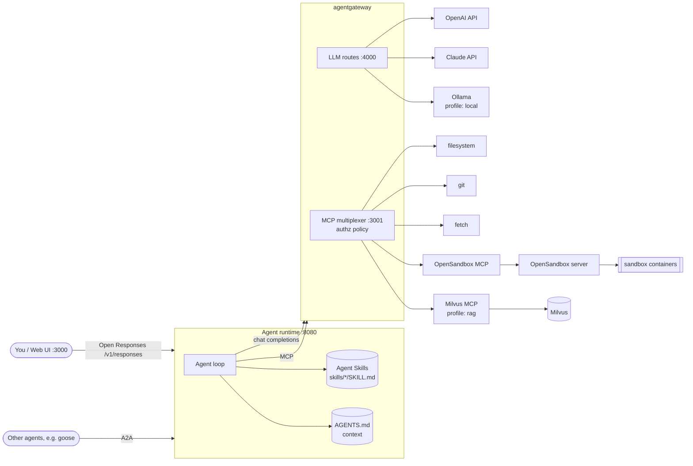

# AAIF Agent Stack

A local, Docker-based reference agent that wires together projects of the
[Agentic AI Foundation](https://aaif.io/) into one working system:

**LLM + Agent Skills + Context + Actions**, with every step visible in a trace.



## How each AAIF project is used

| Layer | Project | Where | What it does here |
|---|---|---|---|
| LLM API | **Open Responses** | `agent/app/main.py`, `agent/app/llm.py` | The agent speaks `POST /v1/responses` (JSON and SSE). Conversation state is a list of Open Responses items. Trace events are an extension (`aaif.trace`). |
| LLM + tool routing | **agentgateway** | `gateway/config.yaml` | One egress: `openai/*` → OpenAI, `anthropic/*` → Claude, `ollama/*` → Ollama container, `ollama-host/*` → native Ollama; all MCP servers multiplexed on one endpoint with tool-name prefixes, CEL authorization, timeouts, OTel tracing. |
| Skills | **Agent Skills** | `skills/`, `agent/app/skills.py` | Progressive disclosure: only name + description in the prompt; `activate_skill` loads `SKILL.md`; `read_skill_file` loads scripts/references/assets. |
| Context | **AGENTS.md** | `workspace/AGENTS.md`, `agent/app/context.py` | Workspace AGENTS.md is always in the system prompt; `load_project_context` loads the AGENTS.md chain for a sub-project (closest wins). The `repo-onboarding` skill *writes* AGENTS.md files. |
| Context + Actions | **Model Context Protocol** | `mcp-servers/`, `agent/app/mcp_tools.py` | Official filesystem, git and fetch servers, OpenSandbox's MCP server and Zilliz's Milvus MCP server, all behind agentgateway. |
| Code execution | **OpenSandbox** | `sandbox/` | Model-written code runs in throwaway containers created by the OpenSandbox server, never in the agent. |
| Agent interop | **Agent2Agent (A2A)** | `agent/app/a2a_server.py`, `scripts/a2a_client.py` | Agent Card at `/.well-known/agent-card.json`, JSON-RPC and REST bindings; skills are advertised as A2A skills. |
| Client | **goose** | see below | goose can use the same gateway MCP endpoint as an extension. |

Milvus is not an AAIF project; it is plugged in purely as one more MCP server (`rag` profile).

## Quick start

Requirements: Docker Desktop (or Docker Engine + Compose v2), ~6 GB free disk for the core
stack (plus ~6 GB for the `local` model, ~2 GB for `rag`).

```bash
cp example.env .env
```

Put a provider key in `.env`: `OPENAI_API_KEY=...` (default model `openai/gpt-5.5`) and/or
`ANTHROPIC_API_KEY=...` (pick an `anthropic/*` model in the UI or set `DEFAULT_MODEL`). Then:

```bash
docker compose up -d --build
```

Open <http://localhost:3000>, pick a model and try the suggested prompts.

| URL | What |
|---|---|
| http://localhost:3000 | Web UI (chat + trace) |
| http://localhost:8080/v1/responses | Open Responses API |
| http://localhost:8080/.well-known/agent-card.json | A2A Agent Card |
| http://localhost:15000/ui | agentgateway admin UI |
| http://localhost:3001/mcp | All MCP tools through the gateway (usable by any MCP client) |
| http://localhost:4000/v1/chat/completions | LLM gateway |

### Profiles

```bash
# Offline: Ollama + qwen3:8b (pulled on first start). Select ollama/qwen3:8b in the UI,
# or set DEFAULT_MODEL=ollama/qwen3:8b in .env.
docker compose --profile local up -d --build

# Knowledge search: Milvus + Milvus MCP server + indexer for workspace/docs
docker compose --profile rag up -d --build
docker compose --profile rag run --rm rag-indexer   # re-index after editing docs

# Traces of every LLM/MCP call from agentgateway in Jaeger (http://localhost:16686)
docker compose --profile observe up -d
```

Profiles combine: `docker compose --profile local --profile rag up -d --build`.

**Faster local models on macOS.** Docker on macOS cannot use the Apple GPU, so the `local`
profile runs Ollama on CPU (one agent turn can take minutes). If you install Ollama natively
(`ollama pull qwen3:8b`, then set `OLLAMA_CONTEXT_LENGTH=16384` for it), use the
`ollama-host/qwen3:8b` model instead: agentgateway routes it to `host.docker.internal:11434`.
Add it to `AVAILABLE_MODELS` in `.env` to see it in the UI.

## Try it

From the UI, or with curl:

```bash
curl -s localhost:8080/v1/responses -H 'content-type: application/json' \
  -d '{"input": "Onboard the repo in /workspace/sample-app and write its AGENTS.md"}' | jq '.output[-1]'
```

Streaming (Open Responses SSE events plus `aaif.trace` events):

```bash
curl -N localhost:8080/v1/responses -H 'content-type: application/json' \
  -d '{"input": "Analyze /workspace/data/sales.csv by region, computed in the sandbox", "stream": true}'
```

Continue a conversation with `"previous_response_id": "<id from the last response>"`.

As another agent, over A2A:

```bash
docker compose exec agent python /scripts/a2a_client.py "What does our runbook say about database is locked?"
```

### Demo scenarios

| Prompt | Skill | Context | Actions |
|---|---|---|---|
| Onboard /workspace/sample-app and write its AGENTS.md | repo-onboarding | AGENTS.md chain, files, git log | `fs_write_file` |
| Analyze /workspace/data/sales.csv by region and product | code-runner | CSV via filesystem | OpenSandbox create/write/run/kill |
| Write a research brief on https://agents.md | research-brief | `web_fetch` | `fs_write_file` to `workspace/briefs/` |
| Our API returns "database is locked", what do we do? | knowledge-search | Milvus BM25 search over `docs/` | — |

## Extending

- **Add a skill**: create `skills/<name>/SKILL.md` with `name` and `description` frontmatter
  ([spec](https://agentskills.io/specification)). It is picked up on the next request; no restart.
- **Add an MCP server**: run it as a container exposing Streamable HTTP (or wrap a stdio
  server like `mcp-servers/stdio-bridge` does) and add a target in `gateway/config.yaml`.
  Its tools appear as `<target>_<tool>`.
- **Add a model provider**: add a route under `llm.models` in `gateway/config.yaml` and list the
  model in `AVAILABLE_MODELS`.
- **Tighten policy**: edit `mcp.policies.mcpAuthorization` in `gateway/config.yaml` (CEL over
  `mcp.tool.name`, `mcp.tool.target`, `mcp.tool.arguments`). The default rule applies least
  privilege: destructive git operations, sandbox administration and Milvus write operations are
  hidden from the agent (the indexer writes to Milvus directly). The gateway hot-reloads the file.

### Use the same tools from goose

goose (an AAIF project) can use the gateway's MCP endpoint as a Streamable HTTP extension:
in `goose configure` → *Add Extension* → *Remote Extension (Streamable HTTP)* →
`http://localhost:3001/mcp`. goose then shares the same tools and gateway policy as this agent.

## Layout

```
agent/            Python agent: Open Responses API, agent loop, skills, context, MCP client, A2A
gateway/          agentgateway config (LLM routes, MCP targets, policy, tracing)
mcp-servers/      stdio-bridge (filesystem, git, fetch via supergateway), milvus
sandbox/          OpenSandbox server config + MCP server image
rag-indexer/      Loads workspace/docs into Milvus (BM25)
skills/           Agent Skills
ui/               Static web UI served by nginx (proxies /v1, /api, /a2a to the agent)
workspace/        The agent's working directory (mounted into the MCP servers)
scripts/          A2A client
```

## Notes and limits

- Conversations and A2A tasks are kept in memory; restarting the agent clears them.
- All ports bind to `127.0.0.1`. There is no authentication; do not expose this stack.
- OpenSandbox mounts the Docker socket to create sandbox containers. The first sandbox
  pulls `python:3.12-slim` and the execd runtime, which can take a minute.
- agentgateway v1.6.0 only supports remote guardrail services for MCP; content masking with
  CEL expressions is on its main branch and can be added after upgrading.
- Small local models follow multi-step skills less reliably than Claude.
